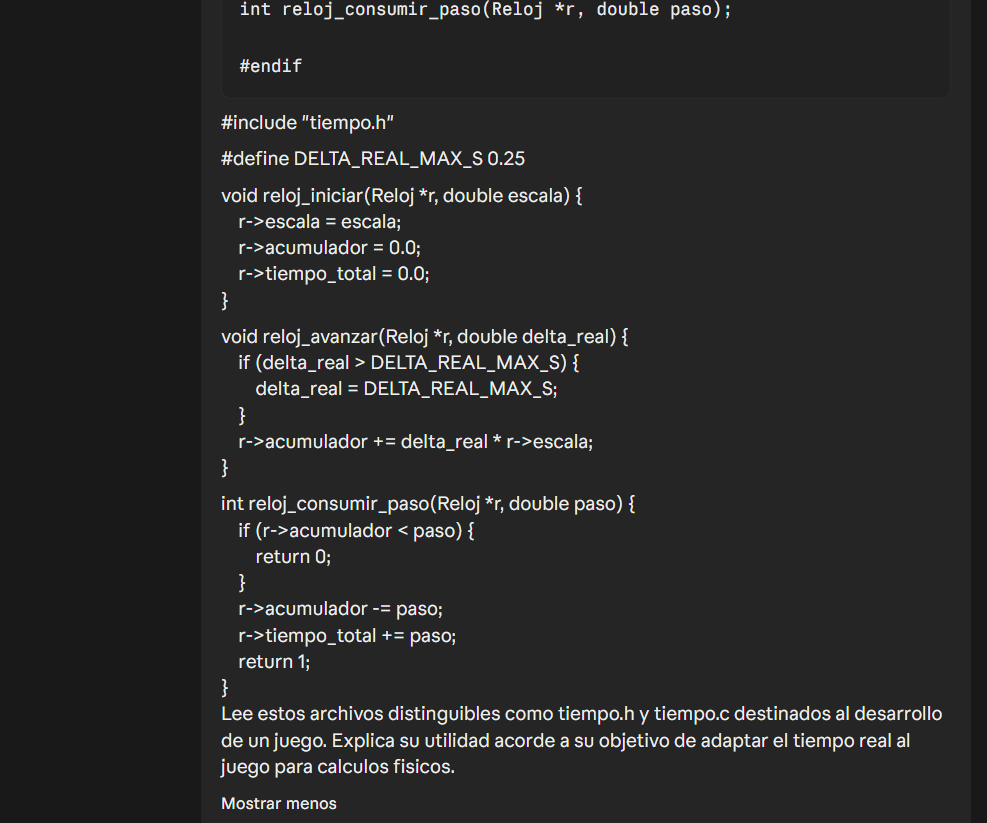
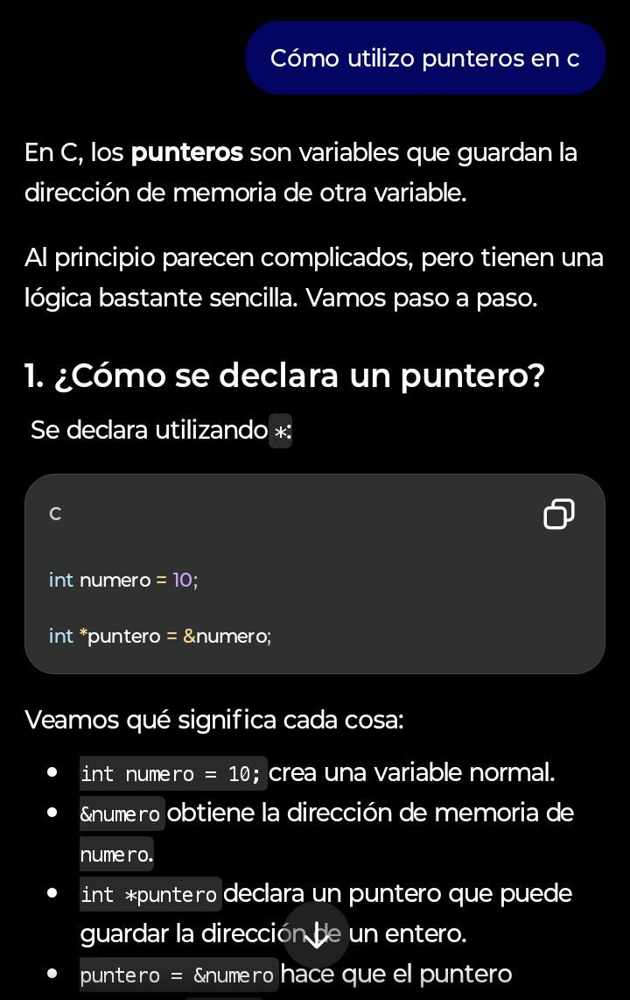
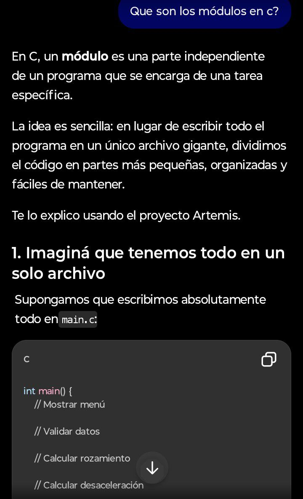
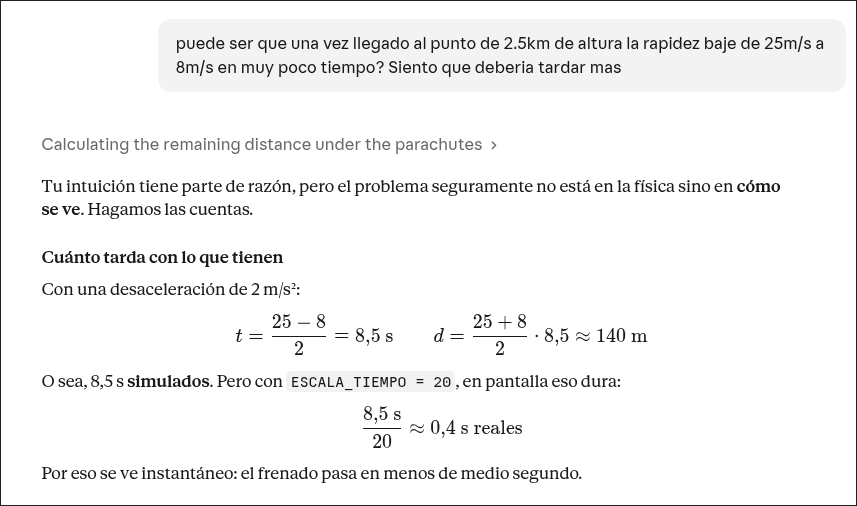
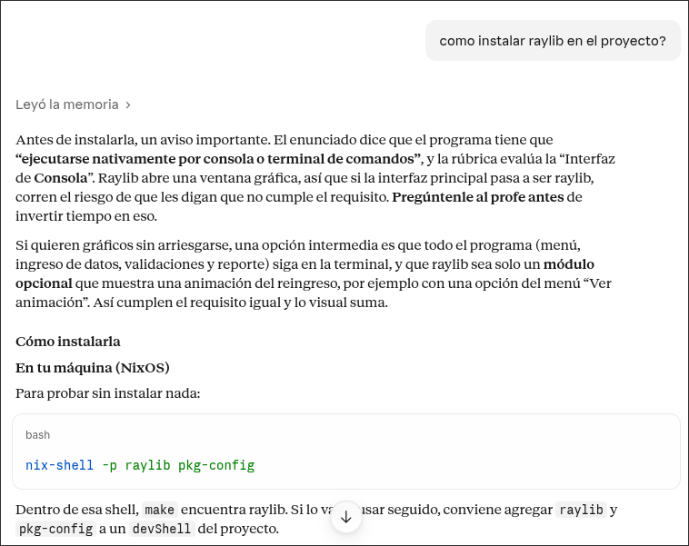
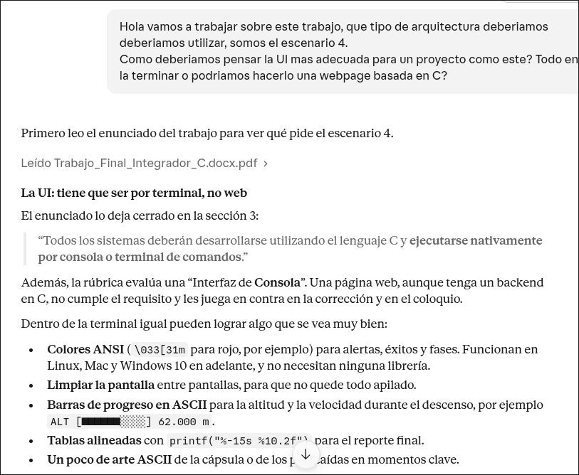
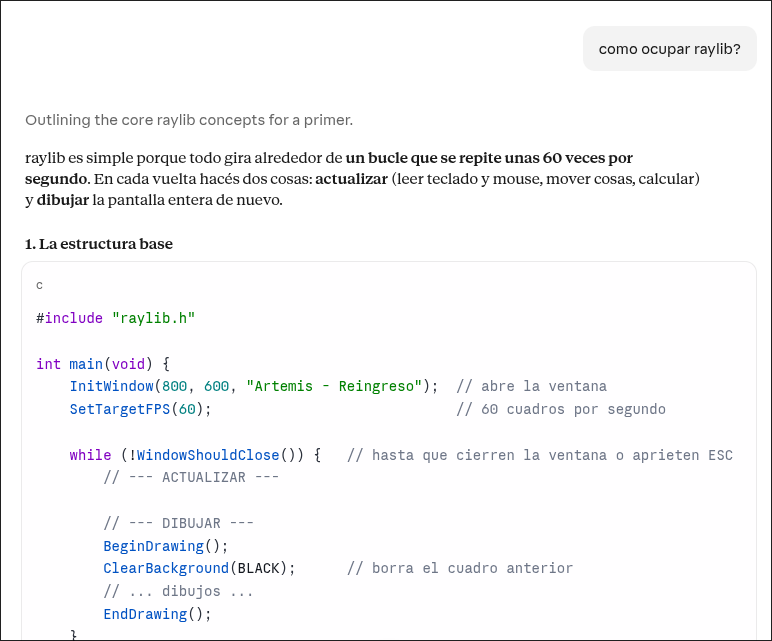
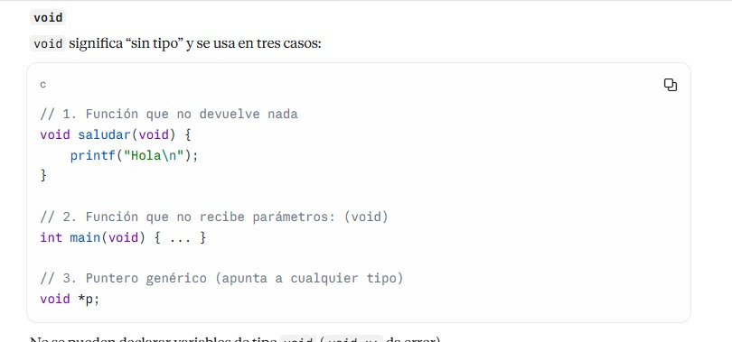
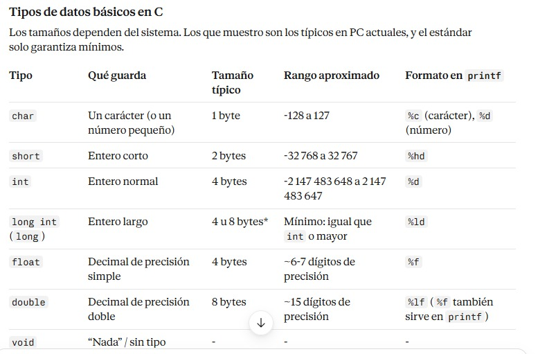

# Artemis AED2026 — Group A21

Trabajo Final Integrador de Algoritmos y Estructuras de Datos (UTN).
Simulador en C del **Escenario 4**: Reingreso Atmosférico, Frenado
Aerodinámico y Amerizaje del módulo Orion. Ver el detalle completo en
[`docs/enunciado.md`](docs/enunciado.md).

## Integrantes

- Saez Jesus
- Ferrario Sanchez Fabrizio Eduardo
- Veron Victor Antonio
- Melanie Milagros Duarte Mikunda
- Martinez Maximo Geronimo
- Gabriel Alejandro Gimenez

## Descripción del escenario

Tras el sobrevuelo lunar, el módulo de tripulación Orion reingresa a la
atmósfera terrestre y es frenado por rozamiento aerodinámico hasta el
despliegue de paracaídas, amerizando finalmente en el Pacífico. El programa
calcula, a partir de los datos del escenario (y permitiendo variar las
entradas):

- El trabajo de la fuerza de rozamiento durante el reingreso.
- La desaceleración media sobre la tripulación (en m/s² y en g).
- La fuerza promedio que ejerce el agua al amerizar.
- Si el ángulo de reingreso está dentro de la ventana segura (5,5° a 7,0°).

## Requisitos

- Descargar w64devkit (para Windows)
- Un compilador de C (`gcc` o `clang`).
- `make`.
  - **Windows**: `make` no viene instalado por defecto. Instalarlo junto a
    un compilador, por ejemplo con [MSYS2](https://www.msys2.org/)
    (`pacman -S make mingw-w64-ucrt-x86_64-gcc`) y agregar esas rutas al
    `PATH`. Alternativamente, se puede usar `make.bat` (ver abajo), que no
    necesita `make` pero sí requiere `gcc` en el `PATH`.
- (Opcional, para autocompletado en el editor) `clangd`.


## Compilación y ejecución

### Linux / macOS

```sh
make start
```

Esto compila el proyecto y ejecuta el binario resultante. También están
disponibles:

```sh
make        # solo compila
make clean  # borra el binario compilado
```

### Windows

Con `make` instalado (ver sección de requisitos):

```sh
make start
```

## Uso de IA

Se utilizo IA para generar la estructura general, para pensar soluciones eficientes, para incorporar las herramientas a utilizarse.
Se utilizo IA para desarrollar rapidamente las funciones que calculan la velocidad de la nave, la fuerza de rozamiento, etc.
Se utilizo IA para desarrollar las instrucciones de instalacion

Prompts utilizadas
#### Fabrizio Ferrario


#### Gabriel Giménez


#### Máximo Martínez



#### Jesús Sáez





#### Víctor Verón


